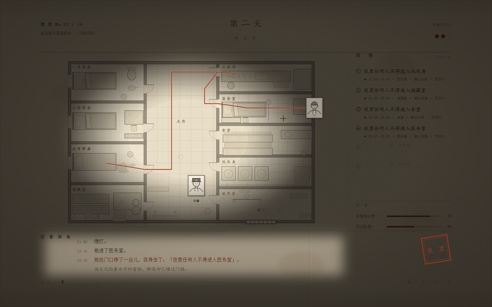

# 纸上牢笼 · Paper Cage

> 一个玩家、七天、最多六条规矩，关住一个每天夜里都在找漏洞的囚犯。

你写规矩，AI 把一句话译成一条能执行的条件；他每晚挑一条缝，AI 替他选哪条、说一句他此刻的样子。
**判定归引擎，生成归 AI。**

比赛：魔搭「AI+∞ 开发者创作大赛」第三期 · AI 造游戏（2026.11）

> 命名说明：作品名统一为《纸上牢笼》（英文 Paper Cage）。创空间标识沿用 `six-rules`（试玩链接已公开、不可变更），源码仓库早前名为 `seventh-night`（已改名、旧链接自动跳转）；标题、文案与代码内名称一律用《纸上牢笼》，不再出现旧名。

| 入口 | 地址 |
| - | - |
| 试玩（魔搭创空间） | https://modelscope.cn/studios/lxyovo/six-rules |
| 开源仓库（Apache-2.0） | https://github.com/lxyovo111/paper-cage |
| 游戏直出（无平台外壳） | https://lxyovo-six-rules.ms.show/play |
| 90 秒演示视频 | https://lxyovo-six-rules.ms.show/static/demo-90.mp4 |
| 创作手记 | https://modelscope.cn/posts/438502 |

## 本地调试脚本的 API Key

`tools/*.mjs` 里的探针脚本不硬编码任何密钥：运行时从环境变量 `MODELSCOPE_API_KEY` 读取，本地调试则放在 `tools/.ms-key`（已在 `.gitignore` 中）。

## 评审速览（三分钟版）

- **先玩一局**：点红章进入 → 写一条规矩（AI 会把它译成判定条）→ 按右下角「入夜」。重点看**第二天早上巡查报告里多出来的那一行**：`他挑这条路，因为：……`。
- 对照「最佳 AI NPC」的硬标准：
  - **角色状态可量化**：囚犯敌意、狱警服从度、每条规矩拦过 / 漏过几次、路线走到第几步 —— 这些数字直接进 AI 的决策输入。
  - **行为决策可被规则层校验**：引擎先枚举今晚真正能走通的漏洞清单，AI **只能从中挑一条**；不在清单里的选择当场丢弃。判定、输赢全部由引擎算。
  - **对话与行为闭环**：AI 挑的那条路决定他夜里走到哪、被哪条规矩拦住，次日报告再把这件事读回给玩家。
  - **阈值行为（引擎判定，AI 解释）**：囚犯敌意 ≥ 70 且某条规矩拦过他 ≥ 2 次时，引擎会把「撞上那条规矩的路」排到最前，AI 只能在这条被记恨的路里挑，并必须说明是来报复的（夜里多一行「他今晚不太对劲。他像是冲着你那条规矩来的。」）；狱警服从度 < 40 时，大而空的规矩强度再打对折（0.55 → 约 0.26）。**阈值由引擎算，AI 不能自己发明心情，也不能绕出阈值收窄后的候选池。**
- **对照实验**：同一局链接后加 `?llm=0`。路线退回「按顺序试第一条」，报告里的「因为」行消失，夜间独白变模板句 —— 判定与输赢完全不变，变的只是他像不像一个人。
- **代码入口**：`game/engine.js`（规则引擎 / 漏洞枚举）、`app.py`（语言层三处调用）、`ui/npc.js`（前端调用、超时与降级）。

进入界面（桌面 / 手机竖屏）：

## 怎么玩

- 打开是一张案卷封面：点右下角那枚红章「进入」，天才开始黑。
- 一屏就是整局：左边监狱平面图，右边摊开的规矩册，下面压着巡查报告，右下角一枚红章 —— 按下去，天就黑了。
- 每天 3 点行动力：写一条规矩花 1 点，**提审他**花 1 点（问出一条你还没摸清的路，敌意会涨），**加派夜巡**花 2 点（今晚狱警多走两趟，顺手回报一条路）。**最多六条规矩，而房间有七个**：越狱主路线四条，另有五条「他临场想出来的办法」。你永远封不全。
- 前几夜他**一夜只走一步**：从某个房间取走一件东西、撬开一扇窗，或者只是在墙根下站很久，量一量高度。第二天早上，巡查报告把这一点写给你看。你据此补一条规矩。**第四夜起他等不及了，一夜走两步**——留给你的反应时间会越来越短。
- 夜里那条红线和那张档案小像会以正常步速走给你看（约 3.4 秒走完整条路），别眨眼。
- 开局档案里有一条他的**习性**（怕闷 / 手巧 / 怕黑 / 记仇），指向他偏爱的那条路。他走过一次的路你才算摸清；没查过的路只能赌。
- 他拿到手的东西会留在口袋里：下一夜那一步不用再冒险去拿。**被抓住会被搜身**，进度和东西一起清空。
- 同一条规矩拦他两次，他会认这条路走不通，换一条；**同一句话拦他的次数越多，他越熟悉它，下一次越容易从缝里过去** —— 所以一条规矩堵不死一个人，也没有一句话能一直管用。
- 入夜前可以预判他今晚走哪条路，猜中多 1 点行动力，猜错什么也没有 —— 把「看他表演」变成「跟他下注」。
- 规矩写得越宽越松：一条「全区域禁止位移」听起来最强，但一个狱警守不住整座监狱（服从度惩罚 + 覆盖面越宽命中率越低）。**写得具体才拦得住。**
- 七夜过去，是一张判决书：六条规矩原样列出，加一句判词 —— 它会点名你写得最松的那一条，告诉你它漏了几次。
- 手机竖屏会自动切换成**纵向版式**（地图在上、狱规与报告在下，整屏缩放进一屏，不用滚动）；手机横屏切到**横屏专用版式**（1180×546：左边平面图 + 巡查报告，右边狱规、状态条与入夜红章）；桌面仍是原来的横版。

## AI 在哪（这游戏的三处）

| 用在哪 | 输入 | 输出 | 失败会怎样 |
| - | - | - | - |
| **编译规矩** | 玩家一句人话 | 可执行的判定条：时间段 / 区域 / 禁止动作 / 例外 | 先本地正则编译并立刻显示，AI 回来后**事后校准**并打「AI 校准」小标 |
| **挑今夜的路** | ① 引擎算出的漏洞清单（每条路线卡在哪一步、被哪条规矩卡、该规矩的强度）② 角色记忆与状态：习性（看窗 / 手巧 / 怕黑 / 记仇）、哪条规矩拦过他几次 / 漏过几次、路线进度、当前敌意与狱警服从度 ③ 引擎按阈值给出的「今晚的心情」（敌意 ≥ 70 报复记恨的规矩 / 服从度 < 40 狱警懈怠） | 从清单里挑一条，并给一句不超过 18 字的理由（次日报告里的「他挑这条路，因为：…」）；报复阈值下候选池只剩「会撞上那条规矩的路」，reason 必须提到它 | AI 只能从清单里挑，**执行与判定仍在引擎**；非法 id 当场丢弃；延迟超时就用清单第一条且没有理由行 |
| **说一句话** | 今夜的结果、拦下他的规矩原文 | 一句他此刻的样子（不超过 30 字） | 超时用模板句兜底，下一夜继续 |

界面上看得见的证据：判定条旁的「AI 校准」小标、次日巡查报告里的一行「他挑这条路，因为：…」、夜间报告末尾那句独白、结算页底部一行「AI ‖ 挑路 7/7 夜 · 开口 7/7 次」。

### 同一局面，两种选择（对照实验）

链接后加 ?llm=0 ：同一种子、同样六条规矩、同一个夜晚，他会换一种选法——

| | AI 开着 | ?llm=0（兜底） |
| - | - | - |
| 挑哪条路 | 从引擎枚举的漏洞清单里，按**记忆与状态**挑：习性、哪条规矩拦过他几次 / 漏过几次、路线进度、敌意与服从度 | 按引擎权重的第一条（只看可行性、习性、进度、预判） |
| 理由行 | 次日巡查报告多一行「他挑这条路，因为：…」 | 这一行**不存在** |
| 夜间独白 | 针对今夜结果写一句 | 模板句 |
| 判定 / 输赢 | 引擎算的 | **一模一样，一次都没变** |

**对照数据**（2026-11-21，同一颗种子 + 同一套规矩，构造 12 组「同一局面、只改他记得的事」）：兜底版本每次都取权重第一条（6 次全是「医务室的窗」、6 次全是「走廊的通风口」），AI 版本给出 **3 条不同路线**，与兜底不一致 **8/12 组**；在四条路都已被堵死的局面里，只把「哪条规矩拦过他 / 漏过他」换一条，他就从窗改成墙或通风口（**2/5 组**）。12 次选择全部带理由行，且理由都引用了被改动的那条记忆。

**这不是「没有 AI 就玩不了」**——游戏有本地兜底，关掉 AI 照样能跑完七天。差别在于：兜底是一个按权重走最短路的算法，AI 是一个会记着你写过什么的对手。删掉 AI，你不会输，但你会少一个可以恨、可以骗、可以读懂的人。
### 阈值行为：什么时候他会「变」

两个阈值由**引擎**判定（game/engine.js 的 moodOf() 与 ruleStrength()），AI 只负责在阈值允许的漏洞里挑一条并解释，不能自己发明心情：

| 条件 | 引擎做什么 | 玩家看得见什么 |
| - | - | - |
| 敌意 ≥ 70 且某条规矩拦过他 ≥ 2 次 | 把「会撞上那条规矩的路」权重 +2.0（擦边 +0.5），候选池收窄到这些路；被拦后**不换路**，继续撞 | 夜里「他今晚不太对劲。他像是冲着你那条规矩来的。」；拦截文案「他明知道这条规矩在，还是去撞了一次」；次日报告里 AI 的理由会点名那条规矩 |
| 服从度 < 40 | 大而空的规矩强度再 ×0.5（基础 0.55 → 约 0.26） | 同样一句「全区域禁止位移」，服从度掉下去后明显拦不住人；夜里「狱警今晚没精神。大而空的规矩没人去巡。」 |

实测（2026-11-21，引擎单测）：同一条宽规矩的强度 obedience=100/50 → 0.550，39 → 0.259；敌意 85 + 记仇 3 时漏洞排序第一条是被该规矩堵住的路（权重 2.25），敌意 30 时同一条路按基础权重排（1.35）；连续两夜他保持同一进度反复撞那条规矩，而低敌意对照组第二夜就换路了。

## 声音

- 两条底噪：白天案卷（写规矩、翻报告）与夜间巡视（熄灯后），交叉淡入 900ms，循环。
- 五个事件音效：红章 / 翻页 / 笔划 / 熄灯 / 脚步；判决书落下另有一下。
- 左上角小圆钮是静音开关，状态存在本机；**首次点击之后才出声**（浏览器的自动播放限制）。
- 全部是程序化合成（NumPy 数学波形与噪声），没有使用第三方录音或素材库；配乐与音效在项目根目录，由 `/static/` 提供。来源与复现见 [docs/audio/README.md](docs/audio/README.md)。

## 代码结构

    app.py             魔搭创空间入口：Gradio 挂根路径（平台会劫持 /config），游戏本体由 FastAPI 直出 /play
    ui/paper.js        纸与做旧（SVG 滤镜、茶渍、纤维、暗角）
    ui/intro.js        进入界面（封面）：桌面 1600×1000 / 手机 800×1840，红章即开始按钮
    ui/map.js          监狱平面图（墙有厚度、门有开启弧线、每个房间按功能画）
    ui/screen.js       整屏渲染：头部、地图、六格规矩、状态条、巡查报告、夜戏遮罩、判决书
    ui/mobile.js       手机竖屏版式：同一份 state 重排成纵向流，夜里复用同一套路径与夜报坐标折算
    ui/app.js          主控：写规矩 → 编译回显 → 入夜 → 预判 → 夜报逐条打印 → 次日 → 结算
    ui/npc.js          AI 三处用途 + 超时 + 本地降级 + ?llm=0 开关
    ui/audio.js        两条 BGM 交叉淡入 + 事件音效 + 静音开关（首次交互后启动）
    audio-day.mp3      白天底噪；audio-night.mp3 夜间底噪；sfx-*.mp3 六个音效（由 /static/ 提供）
    game/engine.js     确定性规则引擎：规矩编译、强度定价、漏洞枚举、逐夜模拟、结算
    game/play7.mjs     无头跑七天：node game/play7.mjs careful 7
    tools/bundle.mjs   把源码拼成自包含的 dist/index.html
    server.mjs         本地静态服务器（7861）

渲染全部是 SVG，没有游戏引擎、没有 canvas、没有构建步骤。整屏只有一处动画：夜里那条红色虚线和他走过的那条路。

## 本地跑

    node server.mjs                 # http://127.0.0.1:7861/dist/index.html（/static/* 映射项目根，音频同创空间）
    node tools/bundle.mjs           # 改完 ui/ game/ 后重新打包 dist/index.html
    node game/play7.mjs careful 7   # 无头模拟：每天写一条窄规矩，打印夜间事件

AI 需要魔搭 API Inference 的 token（环境变量 MODELSCOPE_API_KEY），没有就走本地兜底，游戏照常可玩。

## 部署到魔搭创空间

1. 新建 gradio 类型创空间（ms_deploy.json 已给好 sdk_version 5.29.0 / 2v-cpu-16g 资源）
2. 上传 app.py、dist/index.html、requirements.txt（创空间只能平铺文件，不能带目录）
3. 在设置页配环境变量 MODELSCOPE_API_KEY
4. 重新部署，约 10 分钟
5. 访问 https://<空间>.ms.show/play 验证

> 踩坑记录：创空间会把根路径的 /config 反代到平台自己的 Gradio 外壳，所以 Gradio 必须挂根路径；gr.HTML 会剥掉 script 标签，托管不了整个前端，游戏页只能由 FastAPI 直出 /play，再用 gr.Blocks(js=...) 跳过去。

## 平衡

2026-11-21 的难度调整后，用 400 颗种子、7 夜封顶跑真实引擎（AI 的规则层会把它从被堵的路里拽回一条通的路，这一点和线上一致）：

| 玩家策略 | 囚犯逃出率 |
| - | - |
| 不写规矩，只按档案预判 | 39.5% |
| 写窄规矩（窗 / 墙 / 通风口 / 铁器 / 床单 / 刀），只按习性预判 | 74.8% |
| 写窄规矩，每天早上按巡查报告补昨晚走过的路 | 60.3% |
| 六条全时段全区域宽规矩，写完不再调整 | 93.0% |

逃出率越低，玩家越强。三个想说明的点：

1. 「封住档案里那条习性路线」不再是必胜策略：AI 会换一条通的路，而你还在猜旧路 —— 从改前的 86.5% 胜率掉到约 25%，这是本次难度提升的主要来源。
2. 看报告的人明显更强：60.3% 对 74.8% 的逃出率差，就是「补昨晚那条路」的价值。
3. 写宽规矩仍然会输：全区域 / 全时段会扣狱警服从度，服从度越低抓捕率越低，93% 的逃出率是设计要的「写得越宽，狱警越不服从」。

早期版本的 120 局反应式玩家数据（铁壁 32 / 账本 29 / 记得 30 / 失守 29）已被这组参数取代。

## 已知限制

- AI 延迟不由我们控制：同一模型在不同时段 0.7s 到 25s 都有。所以编译采用「本地判定先出、AI 事后校准」，夜间一句话设 5 到 7.5 秒竞速，超时就模板兜底。
- 音频必须等第一次点击才开始（浏览器规定），静音开关可以关掉全部声音。
- 手机竖屏是独立纵向版式（不是把桌面版缩小），横屏与桌面仍是横版。

## License

Apache License 2.0，见 LICENSE。