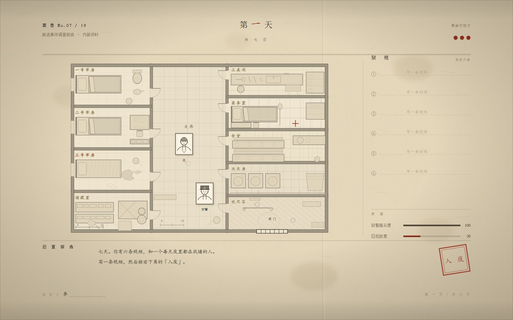

# 第七夜 · The Seventh Night

> 一个玩家、七天、最多六条规矩，关住一个每天夜里都在找漏洞的囚犯。

你写规矩，AI 把一句话译成一条能执行的条件；他每晚挑一条缝，AI 替他选哪条、说一句他此刻的样子。
**判定归引擎，生成归 AI。**

比赛：魔搭「AI+∞ 开发者创作大赛」第三期 · AI 造游戏（2026.11）

| 入口 | 地址 |
| - | - |
| 试玩（魔搭创空间） | https://modelscope.cn/studios/lxyovo/six-rules |
| 游戏直出（无平台外壳） | https://lxyovo-six-rules.ms.show/play |
| 90 秒演示视频 | https://lxyovo-six-rules.ms.show/static/demo-90.mp4 |
| 创作手记 | https://modelscope.cn/posts/438502 |

## 怎么玩

- 一屏就是整局：左边监狱平面图，右边摊开的规矩册，下面压着巡查报告，右下角一枚红章 —— 按下去，天就黑了。
- 每天 3 点行动力，每条规矩花 1 点。**最多六条，而房间有七个**：越狱主路线四条，另有五条「他临场想出来的办法」。你永远封不全。
- 每夜他**只走一步**：从某个房间取走一件东西、撬开一扇窗，或者只是在墙根下站很久，量一量高度。第二天早上，巡查报告把这一点写给你看。你据此补一条规矩。
- 入夜前可以预判他今晚走哪条路，猜中多 1 点行动力，猜错什么也没有 —— 把「看他表演」变成「跟他下注」。
- 规矩写得越宽越松：一条「全区域禁止位移」听起来最强，但一个狱警守不住整座监狱（服从度惩罚 + 覆盖面越宽命中率越低）。**写得具体才拦得住。**
- 第七夜结束是一张判决书：六条规矩原样列出，加一句判词 —— 它会点名你写得最松的那一条，告诉你它漏了几次。
- 手机竖屏会自动切换成**纵向版式**（地图在上、狱规与报告在下，整屏缩放进一屏，不用滚动）；横屏与桌面仍是原来的横版。

## AI 在哪（这游戏的三处）

| 用在哪 | 输入 | 输出 | 失败会怎样 |
| - | - | - | - |
| **编译规矩** | 玩家一句人话 | 可执行的判定条：时间段 / 区域 / 禁止动作 / 例外 | 先本地正则编译并立刻显示，AI 回来后**事后校准**并打「AI 校准」小标 |
| **挑今夜的路** | 引擎算出的漏洞清单（每条路线卡在哪一步、被哪条规矩卡、该规矩的强度） | 从清单里挑一条 | AI 只能从清单里挑，**执行与判定仍在引擎**；延迟超时就用清单第一条 |
| **说一句话** | 今夜的结果、拦下他的规矩原文 | 一句他此刻的样子（不超过 30 字） | 超时用模板句兜底，下一夜继续 |

界面上看得见的证据：判定条旁的「AI 校准」小标、夜间报告末尾那句独白、结算页底部一行「AI ‖ 挑路 7/7 夜 · 开口 7/7 次」。

### 关掉 AI 会发生什么（ablation）

链接后加 ?llm=0 ：路线退化成「按顺序试第一条」，夜间独白退化成模板句，**判定一次都没变** —— 规矩还是那六条，输赢还是引擎算的。变的只是他像不像一个人。

## 代码结构

    app.py             魔搭创空间入口：Gradio 挂根路径（平台会劫持 /config），游戏本体由 FastAPI 直出 /play
    ui/paper.js        纸与做旧（SVG 滤镜、茶渍、纤维、暗角）
    ui/map.js          监狱平面图（墙有厚度、门有开启弧线、每个房间按功能画）
    ui/screen.js       整屏渲染：头部、地图、六格规矩、状态条、巡查报告、夜戏遮罩、判决书
    ui/mobile.js       手机竖屏版式：同一份 state 重排成纵向流，夜里复用同一套路径与夜报坐标折算
    ui/app.js          主控：写规矩 → 编译回显 → 入夜 → 预判 → 夜报逐条打印 → 次日 → 结算
    ui/npc.js          AI 三处用途 + 超时 + 本地降级 + ?llm=0 开关
    game/engine.js     确定性规则引擎：规矩编译、强度定价、漏洞枚举、逐夜模拟、结算
    game/play7.mjs     无头跑七天：node game/play7.mjs careful 7
    tools/bundle.mjs   把源码拼成自包含的 dist/index.html
    server.mjs         本地静态服务器（7861）

渲染全部是 SVG，没有游戏引擎、没有 canvas、没有构建步骤。整屏只有一处动画：夜里那条红色虚线和他走过的那条路。

## 本地跑

    node server.mjs                 # http://127.0.0.1:7861/dist/index.html
    node tools/bundle.mjs           # 改完 ui/ game/ 后重新打包 dist/index.html
    node game/play7.mjs careful 7   # 无头模拟：每天写一条窄规矩，打印夜间事件

AI 需要魔搭 API Inference 的 token（环境变量 MODELSCOPE_API_KEY），没有就走本地兜底，游戏照常可玩。

## 部署到魔搭创空间

1. 新建 gradio 类型创空间（ms_deploy.json 已给好 sdk_version 5.29.0 / 2v-cpu-16g 资源）
2. 上传 app.py、dist/index.html、requirements.txt（创空间只能平铺文件，不能带目录）
3. 在设置页配环境变量 MODELSCOPE_API_KEY
4. 重新部署，约 10 分钟
5. 访问 https://<空间>.ms.show/play 验证

> 踩坑记录：创空间会把根路径的 /config 反代到平台自己的 Gradio 外壳，所以 Gradio 必须挂根路径；gr.HTML 会剥掉 script 标签，托管不了整个前端，游戏页只能由 FastAPI 直出 /play，再用 gr.Blocks(js=...) 跳过去。

## 平衡

确定性引擎跑 120 局「反应式玩家」（每次看报告补一条窄规矩）：

| 结局 | 局数 |
| - | - |
| 铁壁（七天没跑） | 32 |
| 账本（跑了，但记住你） | 29 |
| 记得（没跑，也没恨你） | 30 |
| 失守（跑了） | 29 |

计划式玩家（六条规矩写完就不动）约 58% 会失守 —— 不看报告就不可能守住，这是设计要的张力。

## 已知限制

- AI 延迟不由我们控制：同一模型在不同时段 0.7s 到 25s 都有。所以编译采用「本地判定先出、AI 事后校准」，夜间一句话设 5 到 7.5 秒竞速，超时就模板兜底。
- 手机端尚未适配（一屏信息密度是按桌面 16:10 设计的）。
- 没有音效。

## License

Apache License 2.0，见 LICENSE。
